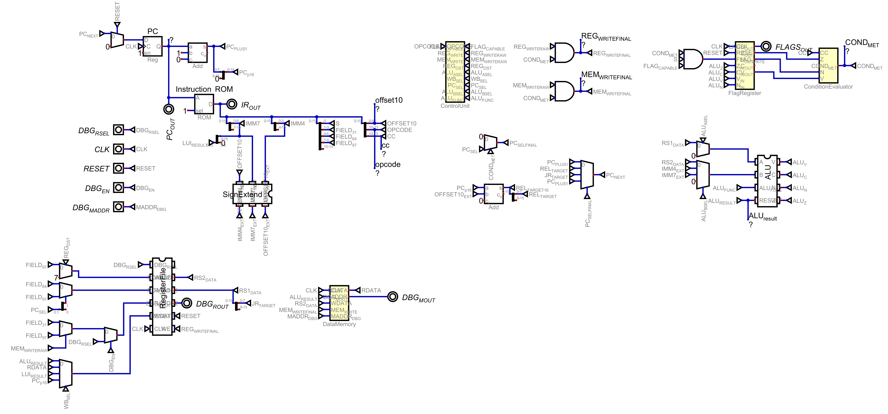
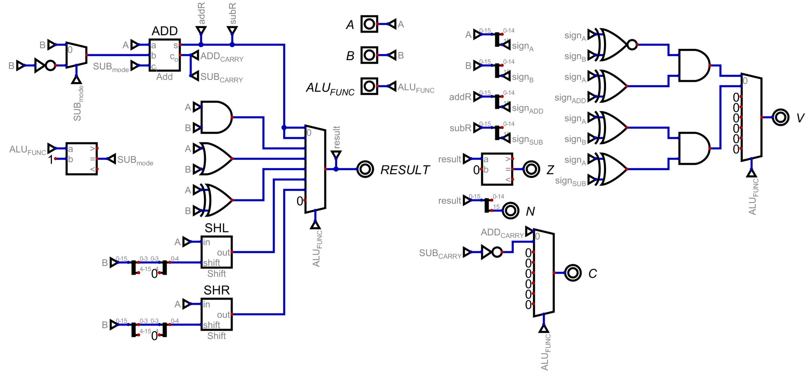
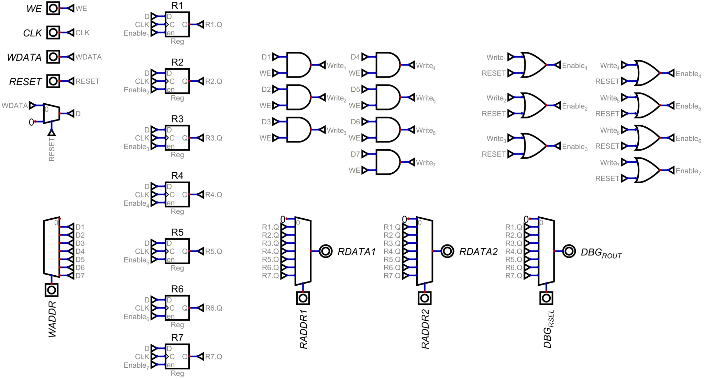

# Pars16 — a custom 16-bit CPU

A processor built from digital logic in [Digital](https://github.com/hneemann/Digital). Pars16 combines a 16-bit datapath, a ROM-based instruction decoder, separate instruction and data memories, and condition-controlled execution. The design includes the complete path from instruction fetch through register writeback.



*The complete processor. [Open the full-size image](docs/images/CPU_403101434.png) to inspect the wiring, or explore the [individual module schematics](docs/architecture.md#component-schematics).*

[View the full schematic](docs/images/CPU_403101434.png) · [Instruction set](docs/instruction-set.md) · [Architecture and signals](docs/architecture.md) · [Demo program](examples/README.md) · [Verification](docs/verification.md)

## Design at a glance

| Feature | Implementation |
| --- | --- |
| Datapath / instruction width | 16 bits / 16 bits |
| Register file | Eight entries: hardwired-zero R0 and seven writable registers; two operand read ports, one write port, and a separate debug read port |
| ALU | ADD, SUB, AND, OR, XOR, logical left shift, logical right shift |
| Status flags | Zero, negative, carry, overflow; optional updates on register ALU instructions |
| Instruction memory | 256 × 16-bit ROM, addressed by an 8-bit program counter |
| Data memory | 65,536 × 16-bit words, with a separate debug read address |
| Control flow | Conditional execution, PC-relative branch, jump-and-link through R7, and register-indirect jump |
| Immediate operands | Signed 4-bit and 7-bit values, signed 10-bit branch displacement, and upper-immediate loading |

The project demonstrates datapath integration, instruction encoding, control-signal generation, register and memory interfaces, and flag-based control flow. It is a simulator design; no FPGA implementation or hardware timing results are claimed.

## Inside the processor

| Arithmetic and logic unit | Register file |
| --- | --- |
|  |  |
| [Explore the ALU](docs/architecture.md#arithmetic-and-logic-unit) | [Explore the register file](docs/architecture.md#register-file) |

The [architecture gallery](docs/architecture.md#component-schematics) also shows the control unit, flag register, condition evaluator, sign extension, and data memory.

## Run the CPU

1. Download and extract [Digital v0.31](https://github.com/hneemann/Digital/releases/tag/v0.31). Digital requires Java 8 or newer; this repository is verified with Java 17.
2. Launch Digital with `java -jar /path/to/Digital.jar`.
3. Open **`circuits/Pars16.dig`**. Keep the other `.dig` files in the same directory so subcircuits resolve correctly.
4. Start simulation. Leave `DBG_EN = 0`, set `CLK = 0`, and set `RESET = 1`. Toggle `CLK` to `1`, back to `0`, and then set `RESET = 0`.
5. Each subsequent low-to-high transition of `CLK` executes one instruction. Follow the [demo walkthrough](examples/README.md) for the expected result.
6. With `CLK = 0`, select a register using `DBG_RSEL` and read `DBG_ROUT`. Select a data-memory word using `DBG_MADDR` and read `DBG_MOUT`. `PC_OUT`, `IR_OUT`, and `FLAGS_OUT` expose the current program counter, current instruction word, and saved flags.

`DBG_EN` is not needed to inspect registers: leave it low during execution. Reset clears the PC, registers, and flags on a rising clock edge, but does not clear data memory. Restart simulation for a fresh memory state; see the [signal notes](docs/architecture.md) before resetting in the middle of a program.

## Repository layout

```text
circuits/
  Pars16.dig              Top-level processor
  ALU.dig                 Arithmetic, logic, shifts, and flag generation
  RegisterFile.dig        Registers, operand reads, writeback, and debug read
  ControlUnit.dig         Opcode-to-control ROM
  ConditionEvaluator.dig  Instruction condition selection
  FlagRegister.dig        Saved status flags
  SignExtend.dig          Immediate and branch-offset extension
  DataMemory.dig          Data RAM and debug read port
docs/                     Architecture, instruction set, and schematic
examples/                 Demo listing, machine code, and expected results
scripts/                  Reproducible simulator verification
```

## Verification

**Eight circuit suites and 1,488 test rows passed with Digital v0.31 and Java 17.** The checks run the actual `.dig` circuits through Digital's native test engine, including the full demo, arithmetic and flag boundaries, register and memory behavior, and exhaustive condition and sign-extension inputs.

```sh
python3 scripts/verify.py --jar /path/to/Digital.jar
```

The runner requires Python 3. The [verification report](docs/verification.md) explains coverage and reproduction. A GitHub Actions workflow runs the same suite on pushes and pull requests. Simulator binaries and Java runtimes are external dependencies and are not included in this repository.

## Design scope

- Instruction addresses wrap to eight bits; data addresses are sixteen bits. Memory is word-addressed.
- Conditions are unconditional, zero, negative, and overflow. Carry is saved for observation but is not an instruction condition.
- R7 is writable and also serves as the link register. Programs must manage it when making nested calls.
- There is no dedicated halt instruction. A branch back to itself provides a stable stopping point for a demonstration.
- `IR_OUT` reflects the ROM word at the current PC; there is no separate instruction register.

The instruction-set reference describes the schematic as implemented, including limits and signal behavior.

## Tools

Created for the [Digital logic simulator by Helmut Neemann](https://github.com/hneemann/Digital). The simulator is distributed separately under its own license.

## License

This project is licensed under the [MIT License](LICENSE).
