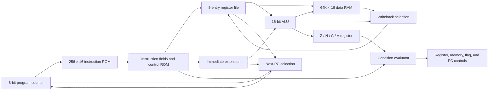
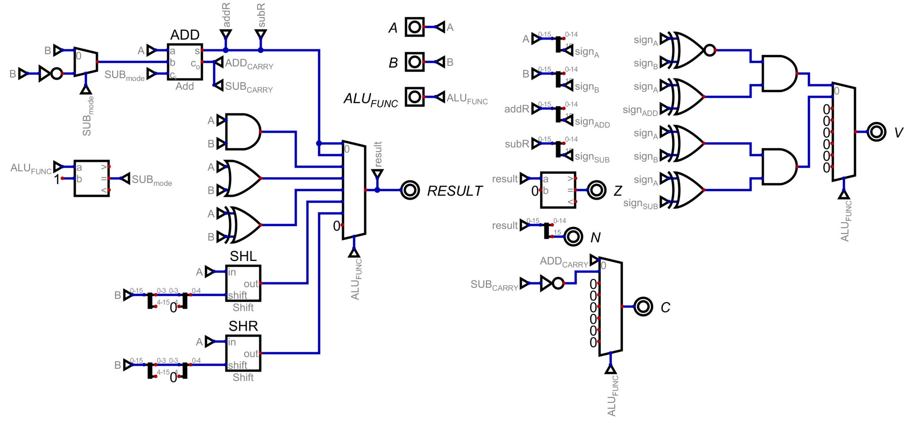
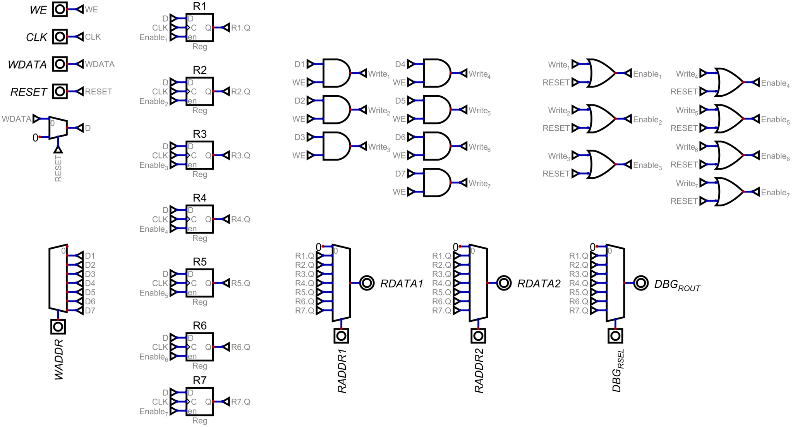
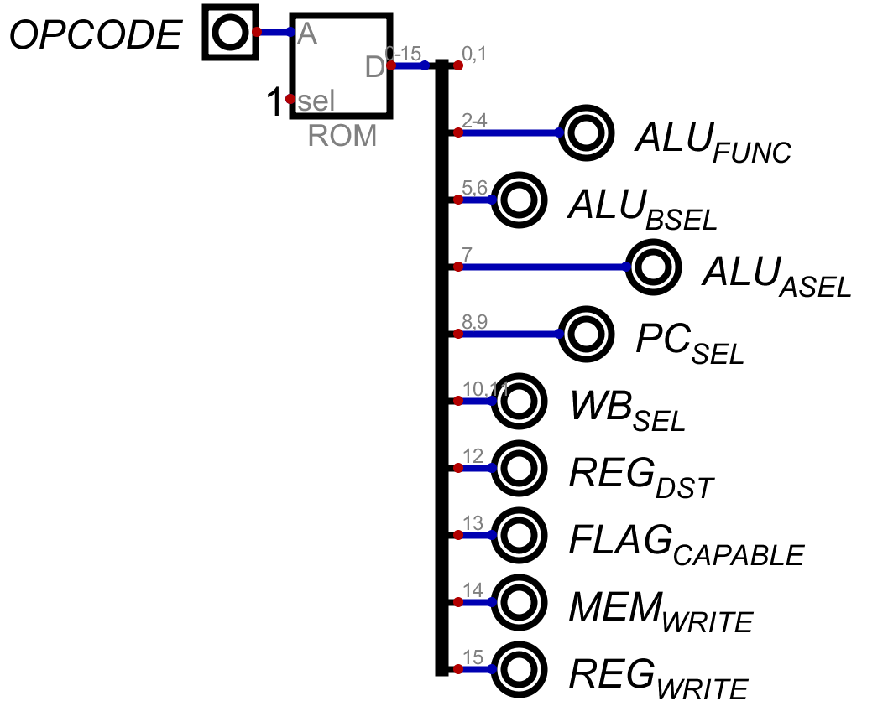
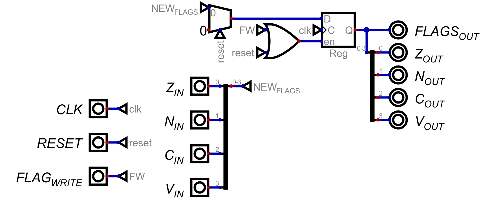
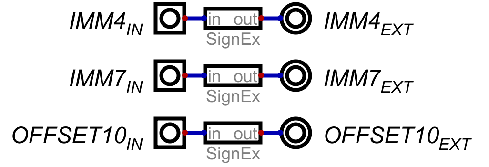
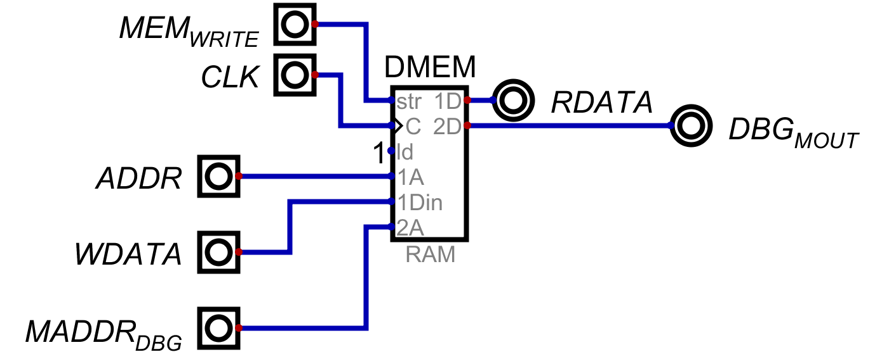

# Architecture and signals

Pars16 uses a combinational instruction/decode/execute path between clocked state elements. The program counter, writable registers, flags, and data-memory writes update on the rising edge of `CLK`.

The diagram groups related controls for readability. The [exported schematic](images/pars16-schematic.svg) contains the exact wiring.

## Instruction execution

1. The eight-bit PC addresses a sixteen-bit instruction in ROM.
2. Splitters extract the opcode, condition, register indices, and immediate fields. A sixteen-entry control ROM generates the datapath selections and write enables.
3. The register file provides two operands. Multiplexers choose registers, zero, or sign-extended immediate values for the ALU.
4. The instruction's two-bit condition is evaluated against saved flags. Failed conditions suppress register writes, memory writes, flag updates, and taken jumps; the PC advances normally.
5. Writeback selects the ALU result, loaded memory data, upper-immediate value, or return address. The next PC selects sequential execution, a relative target, or a register target.
6. A rising clock edge commits the selected state updates.

The flags used for a condition are the previously saved flags. Flag-writing instructions may update them on the same edge that commits the instruction's result.

## Modules

| Circuit | Responsibility |
| --- | --- |
| `Pars16.dig` | Fetch, field extraction, module integration, writeback, PC selection, reset, and debug outputs |
| `ControlUnit.dig` | Four-bit opcode decoder implemented as a ROM of control words |
| `ALU.dig` | Seven ALU operations and combinational Z/N/C/V results |
| `RegisterFile.dig` | Seven physical writable registers, constant R0, two operand read ports, one write port, and an independent debug read port |
| `SignExtend.dig` | Sign-extension of 4-, 7-, and 10-bit fields to sixteen bits |
| `FlagRegister.dig` | Clocked flag storage with reset and update enable |
| `ConditionEvaluator.dig` | Selection of true, Z, N, or V based on the instruction condition field |
| `DataMemory.dig` | Rising-edge RAM writes, combinational reads, and a separate debug read address |

## Component schematics

These views show the internal wiring of each module. Open a schematic to inspect it at full size. The previews display the supplied PNGs on white backgrounds so the black symbols remain visible in either GitHub theme.

### Arithmetic and logic unit

The ALU combines a shared addition/subtraction path, AND/OR/XOR logic, and logical left/right barrel shifts. Result selection feeds the zero and negative flags; separate logic produces carry/borrow and signed overflow.

[Full-size schematic](images/gallery/alu.svg) · [Editable circuit](../circuits/ALU.dig)

### Register file

Seven writable 16-bit registers and a hardwired-zero entry form the eight-entry register interface. Independent read multiplexers serve the two execution operands and the dedicated debug output.

[Full-size schematic](images/gallery/register-file.svg) · [Editable circuit](../circuits/RegisterFile.dig)

### Control unit

A four-bit opcode addresses the control ROM. Its output selects the ALU operation, operands, writeback source, and next-PC path, and enables register, memory, and flag writes.

[Full-size schematic](images/gallery/control-unit.svg) · [Editable circuit](../circuits/ControlUnit.dig)

### Flag register

The flag register stores Z, N, C, and V together, with controlled updates and synchronous reset. It exposes both the packed status word and individual flag outputs.

[Full-size schematic](images/gallery/flag-register.svg) · [Editable circuit](../circuits/FlagRegister.dig)

### Condition evaluator

The two-bit instruction condition selects unconditional execution or the saved zero, negative, or overflow flag. The resulting `COND_MET` signal gates architectural writes and taken jumps in the top-level CPU.

[Full-size schematic](images/gallery/condition-evaluator.svg) · [Editable circuit](../circuits/ConditionEvaluator.dig)

### Sign extension

Dedicated paths sign-extend four-bit immediates, seven-bit immediates, and ten-bit branch displacements to the 16-bit datapath width.

[Full-size schematic](images/gallery/sign-extend.svg) · [Editable circuit](../circuits/SignExtend.dig)

### Data memory

The word-addressed data RAM uses rising-edge writes and combinational reads. A separate address input provides an independent debug view of memory.

[Full-size schematic](images/gallery/data-memory.svg) · [Editable circuit](../circuits/DataMemory.dig)

## External interface

| Signal | Direction / width | Meaning |
| --- | --- | --- |
| `CLK` | Input / 1 | Rising-edge state update |
| `RESET` | Input / 1 | Synchronous clear of PC, writable registers, and flags |
| `DBG_RSEL` | Input / 3 | Register index for the dedicated debug read output |
| `DBG_EN` | Input / 1 | Overrides the ordinary second operand address with `DBG_RSEL`; keep low during normal execution |
| `DBG_MADDR` | Input / 16 | Word address for the separate data-memory debug read |
| `PC_OUT` | Output / 8 | Current instruction address |
| `IR_OUT` | Output / 16 | Combinational ROM word at the current PC |
| `FLAGS_OUT` | Output / 4 | Saved flags; see the instruction reference for bit ordering |
| `DBG_ROUT` | Output / 16 | Contents of the register selected by `DBG_RSEL` |
| `DBG_MOUT` | Output / 16 | Contents of the RAM word selected by `DBG_MADDR` |

### Debugging

The dedicated register debug output is always available. `DBG_EN` is a separate operand-path override, not a CPU pause input. Setting it high can change arithmetic operands and store data on the next clock edge. Inspect state with the clock low and `DBG_EN = 0`.

### Reset and memory

Reset is synchronous: changing `RESET` alone does not clear the PC, registers, or flags. A rising clock edge is required. RAM has no reset connection and retains its contents across CPU resets.

The memory-write enable is gated by the instruction condition, but not by reset. If a store is active when a reset edge occurs, that store can still modify RAM. For a clean initial run, restart the simulation and perform the reset sequence before executing the demo. The demo initializes the memory word it uses.

## Memory and program flow

Instruction and data memories are separate. Instructions cannot write the instruction ROM through the CPU datapath. The PC increments by one sixteen-bit instruction word. Relative targets are formed from `PC + 1` plus a sign-extended ten-bit displacement, then truncated to eight bits; register-indirect jumps also use the low eight bits of their operand.

Data accesses use full sixteen-bit word addresses. A data address of `1` selects the second sixteen-bit RAM word. There is no byte-addressing layer or memory-mapped peripheral interface in this design.
